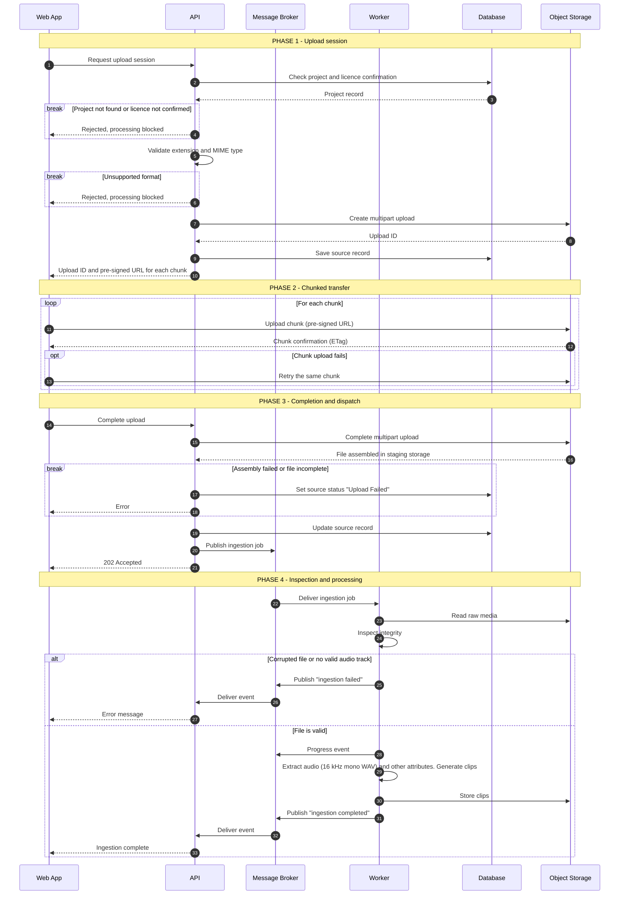
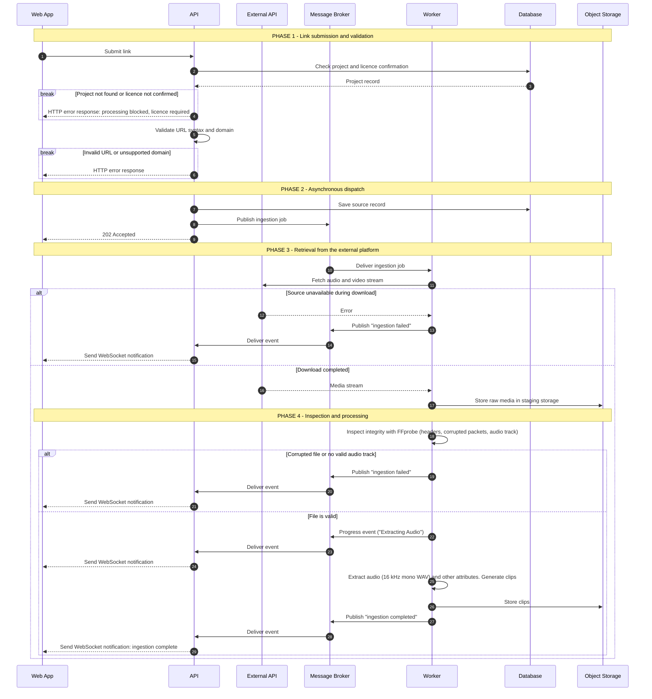

## User Story 03 (US03)
*As a Content Creator, I want to upload a long video directly from my computer, so that I can work with recordings that only exist locally.*

## User Story 04 (US04)
*As a Content Creator, I want to import a video from an authorized link, so that I do not have to download the recording and upload it again.*

